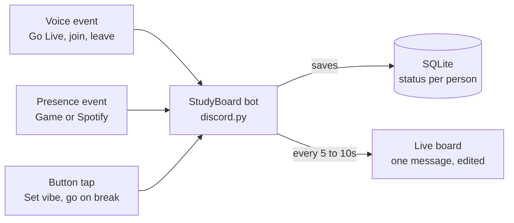

# StudyBoard: Live board plan

StudyBoard is a Discord bot that keeps one live message showing who is streaming what, so students can join a session that fits their mood instead of clicking through a wall of stream tiles.

## Overview

- **Problem:** in a group study server, 6+ people streaming lo-fi, games or lectures means many separate tiles with no context.
- **Solution:** one pinned board, grouped into Studying, On break and Lecture, with a Join button per person.
- **Goal:** make it easy to join someone's lo-fi session while studying, or someone's game while on break.
- **Where to test:** a private channel in the Agora server.

## How it looks

The board is one bot message in `#now-streaming`. The bot edits it in place and never posts a new one.

```
┃ #now-streaming · StudyBoard
┃
┃ Studying (2)
┃  (MK) Maya   Lo-fi beats · 1h 20m · Lofi room              [Join]
┃  (JT) Jay    Electronic · 35m · Electronic room             [Join]
┃ ─────────────────────────────────────────────────────────────
┃ On break (1)
┃  (SK) Shun   Valorant · 10m · Break room                    [Join]
┃ ─────────────────────────────────────────────────────────────
┃ Lecture (1)
┃  (AL) Ana    CSC 413 recording · 50m · Lecture room         [Join]
┃
┃ Updated a few seconds ago

[Set my vibe]  [Go on break]  [Clear status]
```

*Names and statuses are placeholders.*

**Sections** (built with Discord's Components V2)

| Section | Who shows here | Example row |
| --- | --- | --- |
| Studying | In voice with a study vibe (lo-fi, electronic, brown noise) | Maya · Lo-fi beats · 1h 20m · Lofi room · [Join] |
| On break | Playing a game or tapped Go on break | Shun · Valorant · 10m · Break room · [Join] |
| Lecture | Streaming or watching a class recording | Ana · CSC 413 recording · 50m · Lecture room · [Join] |

**Each row:** avatar thumbnail, name, what they're streaming, how long, which voice channel, and a Join link button.

**Buttons under the board**

- **Set my vibe:** opens a dropdown only you see (Lo-fi, Electronic, Brown noise, Lecture, Gaming, Custom). It remembers your last pick.
- **Go on break:** moves you to On break, and can also move you to the break voice channel.
- **Clear status:** resets your vibe.

**Footer:** "Updated a few seconds ago". When no one is live, show "No one's live. Start a session!"

## How it works



Discord sends the bot an event whenever someone streams, changes activity or taps a button. The bot saves each person's status, then re-renders the one board message in a batch every 5 to 10 seconds to stay under rate limits.

## Possible vs not possible

The bot can read who is streaming and what they're doing, but it can never touch the stream video itself.

| Possible | Not possible |
| --- | --- |
| See who's streaming with Go Live, and in which voice channel | Merge everyone's video into one box |
| See a game or Spotify track (Presence Intent) | Change Discord's stream tile layout |
| Join button that opens a person's voice channel | Join button that opens one specific stream directly |
| Self-tagged vibes like lo-fi, brown noise, lecture | Detect YouTube or browser audio without a tag |
| Session timers, sections, avatars | Client mods (against Discord's ToS) |

## Build phases

Ship each phase before starting the next. The live board is the Phase 2 target.

**Phase 0: vibe channels (1 day, no code)**

- [ ] Create voice channels: Lofi room, Electronic room, Break room, Lecture room
- [ ] Watch for a week whether people use them

**Phase 1: basic bot (a weekend)**

- [ ] Make the bot app in the Developer Portal, turn on the Presence and Server Members intents
- [ ] discord.py: listen to `on_voice_state_update` and `on_presence_update`
- [ ] Post a plain text list of who's live, with Join links
- [ ] Add `/vibe` slash command

**Phase 2: live board (1 to 2 weeks)**

- [ ] Switch to one message the bot edits, built with Components V2
- [ ] Save the board message ID in SQLite so it survives restarts
- [ ] Group rows into Studying, On break, Lecture
- [ ] Add Set my vibe, Go on break, Clear status buttons
- [ ] Batch edits every 5 to 10 seconds
- [ ] Session timers and the empty state
- [ ] Cap rows at 40 components, show "+N more"

**Phase 3: maybe**

- [ ] Discord Activity version (Embedded App SDK) with a shared study timer
- [ ] Move this plan to a GitHub repo README and turn phases into Issues

## Risks and open questions

The biggest risk is that people skip tagging their vibe, so the board shows blanks.

- **Vibe tagging:** remember each person's last vibe so they rarely need to tap it again.
- **Rate limits:** many people starting or stopping at once can throttle edits; batching fixes it.
- **Big groups:** 40-component cap per message; decide who shows first.
- **Privacy:** some people may not want their game or Spotify shown. Add an opt-out?
- **Open question:** does Go on break also move people between voice channels, or only change the board?
- **Open question:** one board per server, or one per study voice channel?
